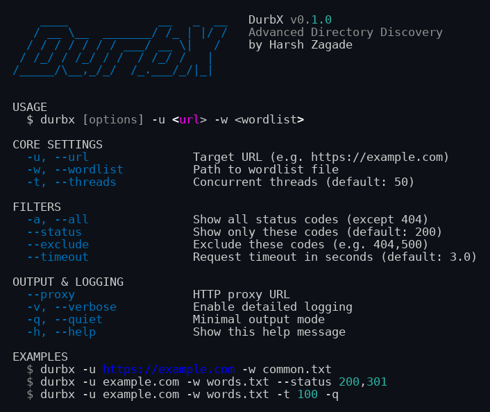
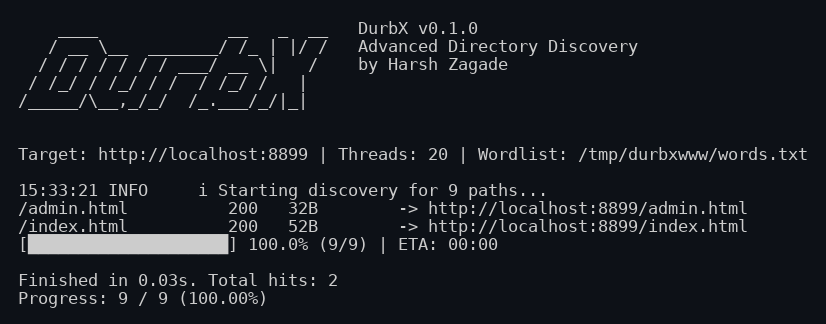

# DurbX

<p align="center">
  
  
  
</p>

**DurbX** is an asynchronous directory and file discovery tool for web targets. Give it a URL and a wordlist, and it concurrently requests each path, reporting the ones that respond — with status code, response size, and redirect target — while filtering out the noise (404s by default). It is built on `aiohttp` for high-concurrency scanning with a bounded worker pool, DNS caching, and a live progress bar.

---

## 📸 Screenshots

Real terminal captures from an actual run (local test server — no real target was scanned):

**Help screen**



**Live scan**



---

## ✨ Features

- **Async engine** — built on `aiohttp` + `asyncio`; one worker per thread-slot with a bounded `TCPConnector` pool, so concurrency never exhausts resources
- **Smart filtering** — shows only `200 OK` by default; `--all` shows everything except 404; `--status` allowlist and `--exclude` denylist for precise control, both accepting inclusive ranges (`--status 200-299`, `--exclude 500-599`)
- **Fast feedback** — real-time progress bar with ETA, color-coded results, per-request timeout (default 3s)
- **Wordlist handling** — strips whitespace and leading slashes, drops duplicates, skips `#` comments and blank lines
- **Extension probing** — `-x php,html` requests each word plus its extension variants (e.g. `/admin`, `/admin.php`, `/admin.html`)
- **URL normalization** — `example.com` becomes `https://example.com` automatically
- **Proxy support** — route traffic through an HTTP proxy (e.g. Burp Suite) with `--proxy`
- **Output modes** — verbose logging (`-v`) for debugging, quiet mode (`-q`) that suppresses the banner and summary lines for cleaner piped output, `--no-color` that strips ANSI colors from the banner, hit lines, and summary without suppressing any output (unlike `-q`), `-o/--output` to save hits to a file (`--append` accumulates across runs instead of overwriting)
- **Directory-listing detection** — 200 responses whose body looks like a server autoindex page (`<title>`/`<h1>` "Index of /...") are flagged `(directory listing)` in terminal, `-o`, and `--json` output, with a count in the final summary (HEAD scans cannot flag listings, since HEAD responses carry no body)
- **Graceful errors** — connection errors and timeouts are caught per-request; `Ctrl+C` exits cleanly
- **Rate-limit handling** — backs off and retries HTTP 429 responses (exponential backoff, honors the server's `Retry-After` header in both delta-seconds and HTTP-date forms); `--retry-on 500,502,503` extends the same backoff/`Retry-After` handling to transient server errors (ranges like `500-599` accepted); tune the retry count with `--retries`; hits that needed retries are marked `(retried N)` in terminal, `-o`, and `--json` output so rate-limit pressure stays visible instead of silent
- **Stealth controls** — `--delay` pauses each worker between requests for slower, quieter scans on rate-limited targets; `--rate-limit RPS` caps the global request rate across all workers via a shared token bucket, for targets with strict server-side limits; `--user-agent` overrides the default `DurbX/0.1` User-Agent header; `--random-agent` rotates the User-Agent per scan request from a built-in list of common browser agents (overrides `--user-agent`; an explicit `-H User-Agent` header still wins; the soft-404 probe keeps the session agent)
- **HTTP method choice** — `-m/--method GET|HEAD|POST` swaps the request verb instead of hard-coding GET (HEAD is lighter on big targets; POST catches methods-only endpoints)
- **Redirect following** — `--follow-redirects` follows 3xx responses instead of reporting the redirect itself, so results reflect the final status (the soft-404 probe follows the same policy so filtering stays consistent); without it, 3xx hits show the captured `Location` header as their destination instead of repeating the requested URL, and `--json` carries it as `redirect_target`
- **Custom headers** — repeatable `-H/--header "Name: value"` sends custom HTTP headers (auth cookies, tokens) with every request; a custom `User-Agent` header overrides `--user-agent`
- **Wildcard detection** — before the scan, a random nonexistent path is probed; responses matching its status + body size (soft-404 catch-all pages) are auto-filtered, with a count in the summary (`--no-wildcard` disables)
- **Multi-target scans** — `--targets FILE` scans several base URLs from one file (one per line, `#` comments and blanks skipped, targets normalized and deduped); each target gets its own wildcard probe, and `-o` output groups hits under `# Target: <url>` section headers
- **Body-size filtering** — `--filter-length N` (gobuster-style) hides responses whose body size equals N, for cutting through identical-size noise; comma-separated for several sizes, applies even under `--all`
- **Body-size matching** — `--match-length N` is the inverse: show ONLY responses whose body size equals N, for zeroing in on a known interesting size; comma-separated, combines (AND) with the status filters
- **Path exclusion** — `--exclude-path REGEX` (repeatable) skips wordlist entries matching a regex before any request is sent, for cutting noisy subtrees (e.g. `--exclude-path '^assets/'`); matched against the entry as written, before `-x` extension expansion, so one pattern drops the whole subtree including its variants; malformed patterns fail fast
- **Stdin path input** — `--stdin` (or `-w -`) reads candidate paths from stdin instead of a wordlist file, so DurbX pipes cleanly from other recon tools (`other-tool | durbx -u example.com --stdin`); same normalization as wordlist files (blanks, `#` comments, duplicates dropped)
- **JSON report** — `--json report.json` writes a machine-readable final report (every hit plus an aggregate `stats` block: completed/total, hit count, wildcard-filtered count, duration) for CI and recon pipelines
- **CSV report** — `--csv report.csv` writes the same hits as one row per hit (target, path, URL, status, reason, size, attempts, directory listing, redirect target, duplicate count, latency) for spreadsheet pipelines; fields with commas, quotes, or newlines are quoted so they round-trip exactly
- **JSON Lines report** — `--jsonl report.jsonl` writes one JSON object per hit (exactly the same per-hit fields as `--json`) for streaming pipelines; no `stats` block, since JSONL is a per-hit format
- **Sorted output** — `--sort` orders hits by path (case-insensitive) in `-o`/`--json`/`--jsonl`/`--csv` output, per target, so repeated runs diff cleanly instead of following worker completion order; live terminal lines still print as hits arrive
- **Per-status breakdown** — the final summary reports hit counts per status code (`by status: 200: 3, 403: 1`) instead of only a total, and `--json` carries the same breakdown as `stats.status_counts`, so the shape of a scan's results is visible at a glance
- **Request latency** — every hit carries its request time (retries included), the final summary reports the average plus the 3 slowest hits, and `--json` carries `avg_latency_ms`, `slowest_hits`, and per-hit `latency_ms`, so slow paths stand out instead of hiding in the total duration
- **Duplicate-body dedupe** — 200 responses whose first 8 KB hash identically (SHA-256) collapse into one representative row with an `(xN identical bodies)` count, for template-duplicate pages the wildcard filter cannot catch (same size is not required, same first-8KB hash is); the collapsed count is tallied in the final summary and `--json` stats, and each hit carries its `duplicate_count` (HEAD scans never dedupe, since HEAD responses carry no body)
- **Tech-header summary** — `Server` and `X-Powered-By` values seen across displayed hits are counted and reported in the final summary (`Tech headers: Server: nginx/1.18 (2), Apache (1); X-Powered-By: PHP/8.1 (1)`), and carried as `stats.tech_headers` in `--json` reports, so the target's stack is visible at a glance
- **Resume support** — `--checkpoint cp.json` writes progress checkpoints during a scan (temp-file + rename, so a kill never corrupts it); `--resume cp.json` continues an interrupted scan exactly where it stopped, skipping already-scanned entries. Single-target only; the checkpoint refuses mismatched targets/wordlists and already-finished scans

---

## 📦 Installation

### Using pipx (recommended)

```bash
git clone https://github.com/harshzagade/DurbX.git
cd DurbX
pipx install .
```

### Using pip

```bash
pip install .
```

Requires Python 3.10+ and the dependencies in `requirements.txt` (`aiohttp`, `colorama`, `rich`).

---

## 🚀 Quick Start

```bash
# Basic scan: show only 200 OK responses
durbx -u https://example.com -w wordlist.txt

# High-concurrency scan
durbx -u https://example.com -w wordlist.txt -t 100

# Show everything except 404
durbx -u https://example.com -w wordlist.txt -a

# Show only specific status codes
durbx -u https://example.com -w wordlist.txt --status 200,301,403

# Exclude noisy codes
durbx -u https://example.com -w wordlist.txt --exclude 404,500,503
```

> ⚠️ Only scan targets you own or are authorized to test. See the [Disclaimer](#-disclaimer).

---

## 📖 Usage Examples

All flags below are verified against `durbx --help`.

```bash
# Scan through a proxy (e.g. Burp Suite)
durbx -u https://example.com -w wordlist.txt --proxy http://127.0.0.1:8080

# Custom per-request timeout (seconds)
durbx -u https://example.com -w wordlist.txt --timeout 5

# Control 429 retry behavior (default: 3 retries with backoff; 0 disables)
durbx -u https://example.com -w wordlist.txt --retries 5

# Retry transient server errors too, with the same backoff/Retry-After handling
durbx -u https://example.com -w wordlist.txt --retry-on 500,502,503

# Stealthy scan: 0.5s pause between requests per worker
durbx -u https://example.com -w wordlist.txt --delay 0.5

# Custom User-Agent (default: DurbX/0.1)
durbx -u https://example.com -w wordlist.txt --user-agent "Mozilla/5.0"

# Quiet mode: banner and summary suppressed, results stream cleanly
durbx -u https://example.com -w wordlist.txt -q

# No colors, but banner and summary still print (clean piped logs)
durbx -u https://example.com -w wordlist.txt --no-color

# Save discovered hits to a file (plain text, no color codes)
durbx -u https://example.com -w wordlist.txt -o hits.txt

# Accumulate hits across runs instead of overwriting the file
durbx -u https://example.com -w wordlist.txt -o hits.txt --append

# Machine-readable JSON report (hits + stats) for pipelines
durbx -u https://example.com -w wordlist.txt --json report.json

# Long scan? Write checkpoints, then resume after an interrupt
durbx -u https://example.com -w biglist.txt --checkpoint cp.json
durbx --resume cp.json -w biglist.txt

# Verbose logging
durbx -u https://example.com -w wordlist.txt -v

# Scheme is optional; -t sets concurrency (default: 50)
durbx -u example.com -w words.txt -t 20

# Probe file extensions for every word (word, word.php, word.html, ...)
durbx -u example.com -w words.txt -x php,html

# Disable soft-404 wildcard detection
durbx -u example.com -w words.txt --no-wildcard

# Send custom headers (repeatable) — e.g. auth cookies or tokens
durbx -u example.com -w words.txt -H "Authorization: Bearer abc" -H "X-Debug: 1"
```

### Integration

```bash
# Pipe hits into httpx
durbx -u example.com -w wordlist.txt -q | httpx -silent

# Save results
durbx -u example.com -w wordlist.txt -q > found.txt
```

---

## 📊 Sample Output

Actual output from a scan against a local test server (`python3 -m http.server`):

```
    ____             __   _  __   DurbX v0.1.0
   / __ \__  _______/ /_ | |/ /   Advanced Directory Discovery
  / / / / / / / ___/ __ \|   /    by Harsh Zagade
 / /_/ / /_/ / /  / /_/ /   |
/_____/\__,_/_/  /_.___/_/|_|

Target: http://localhost:8899 | Threads: 20 | Wordlist: words.txt

15:33:21 INFO     i Starting discovery for 9 paths...

/admin.html          200   32B        -> http://localhost:8899/admin.html
/index.html          200   52B        -> http://localhost:8899/index.html
[████████████████████] 100.0% (9/9) | ETA: 00:00

Finished in 0.03s. Total hits: 2
Progress: 9 / 9 (100.00%)
```

Status colors: `200` green, `301`/`302` magenta, `403` yellow, `500+`/errors red, `404` hidden by default.

---

## 🔧 CLI Options

```
USAGE
  $ durbx [options] -u <url> -w <wordlist>

CORE SETTINGS
  -u, --url               Target URL (e.g. https://example.com)
  --targets               Target list file (one URL per line; use instead of -u)
  -w, --wordlist          Path to wordlist file (use - for stdin)
  --stdin                 Read candidate paths from stdin (instead of -w)
  -x, --extensions        Append extensions to each word (e.g. php,html)
  -t, --threads           Concurrent threads (default: 50)
  --delay                 Pause between requests per worker (default: 0)
  --user-agent            Custom User-Agent header (default: DurbX/0.1)
  --random-agent          Rotate User-Agent per request (built-in browser list)
  -H, --header            Custom HTTP header (repeatable; overrides --user-agent)
  -m, --method            HTTP request method (default: GET; GET/HEAD/POST)

FILTERS
  -a, --all               Show all status codes (except 404)
  --status                Show only these codes (default: 200)
  --exclude               Exclude these codes (e.g. 404,500)
  --filter-length         Hide responses with these body sizes (e.g. 1234,5678)
  --match-length          Show only responses with these body sizes (e.g. 1234,5678)
  --exclude-path          Skip wordlist entries matching a regex (repeatable; before -x expansion)
  --timeout               Request timeout in seconds (default: 3.0)
  --retries               Retry retryable statuses with backoff (default: 3; 0 disables)
  --retry-on              Statuses to retry like 429 (e.g. 500,502,503; default: 429 only)
  --no-wildcard           Disable soft-404 wildcard detection
  --follow-redirects      Follow 3xx redirects (default: report them)

OUTPUT & LOGGING
  --proxy                 HTTP proxy URL
  -o, --output            Save hits to a file
  --append                Append hits to the -o file instead of overwriting it
  --json                  Save a machine-readable JSON report (hits + stats) to a file
  --jsonl                 Save a JSON Lines report (one JSON object per hit) to a file
  --csv                   Save a CSV report (one row per hit) to a file
  --sort                  Sort hits by path in -o/--json/--jsonl/--csv output (per target)
  --checkpoint            Write resume checkpoints during the scan (single-target)
  --resume                Resume an interrupted scan from a checkpoint (single-target)
  -v, --verbose           Enable detailed logging
  -q, --quiet             Minimal output mode
  -h, --help              Show this help message

EXAMPLES
  $ durbx -u https://example.com -w common.txt
  $ durbx --targets targets.txt -w common.txt -q
  $ durbx -u example.com -w words.txt --status 200,301
  $ durbx -u example.com -w words.txt -t 100 -q
```

---

## 🎯 How It Works

1. **URL normalization** — `example.com` → `https://example.com`
2. **Wordlist loading** — strip whitespace/leading slashes, drop duplicates, skip `#` comments; `--exclude-path` drops entries matching a regex before any request is sent
3. **Wildcard probe** — a random nonexistent path is requested first; if the server answers anything other than 404, its status + body size become a soft-404 fingerprint
4. **Concurrent scan** — a bounded `aiohttp` worker pool (size = `-t`, default 50) GETs each path and records status code, reason, and body size
5. **Result filtering** — responses matching the wildcard fingerprint are hidden (counted in the summary); then `--status` allowlist wins; else `--all` shows everything except 404; else only `200` is shown; `--exclude` removes codes from any view
5. **Live display** — results print as they arrive; a progress bar tracks completion with ETA; a summary (`Finished in Xs. Total hits: N`) closes the run

---

## 🏗️ Project Layout

```
src/durbx/
├── cli.py           # Argument parsing and main entry point
├── enumerator.py    # Async HTTP engine, wordlist loading, filtering
├── formatter.py     # Result colorization and formatting
└── utils.py         # ASCII branding, logging setup, help text
tests/
└── test_core.py     # Unit tests (URL normalization, wordlist parsing,
                     # filtering, result formatting, CLI flags)
```

---

## 🧪 Testing

```bash
pip install -e .
pip install pytest
python -m pytest tests/ -q
```

The suite (8 tests, all passing) covers URL normalization, wordlist dedup/comment handling, status-code parsing, result filtering, result formatting, and CLI flag parsing. There are no network-dependent tests — scanning is exercised manually:

```bash
# Local end-to-end check (no external target needed)
mkdir -p /tmp/durbx-test && echo hi > /tmp/durbx-test/index.html
python3 -m http.server 8899 -d /tmp/durbx-test &
printf 'index.html\nadmin\nlogin\n' > /tmp/words.txt
durbx -u http://localhost:8899 -w /tmp/words.txt -t 20
# Expected: finds /index.html (200), finishes in well under a second
```

See [TESTING_NOTES.md](./TESTING_NOTES.md) for the documented `--all`-flag bug fix and manual test notes.

---

## 📝 Changelog

See [CHANGELOG.md](./CHANGELOG.md) for release history.

---

## 📚 Wordlist Recommendations

- **Small / fast:** SecLists `Discovery/Web-Content/common.txt` (~4.6k entries) — good for quick passes
- **Medium / balanced:** SecLists `Discovery/Web-Content/directory-list-2.3-medium.txt` (~220k entries)
- **Large / thorough:** SecLists `Discovery/Web-Content/directory-list-2.3-big.txt` (~1.2M entries)

```bash
git clone https://github.com/danielmiessler/SecLists.git
```

---

## 🛡️ Best Practices

1. **Start small** — validate with a short wordlist and low thread count first (`-t 10`)
2. **Respect rate limits** — drop `-t` on sensitive or slow targets
3. **Tune the timeout** — raise `--timeout` for slow servers instead of re-running
4. **Filter deliberately** — `--status 200,403` focuses the signal; `-a` when you want the full picture

---

## 🤝 Contributing

Contributions are welcome! Please feel free to submit a Pull Request.

---

## 📄 License

This project is licensed under the MIT License — see the [LICENSE](LICENSE) file for details.

---

## 👤 Author

**Harsh Zagade**
- GitHub: [@harshzagade](https://github.com/harshzagade)
- LinkedIn: [harsh-zagade](https://linkedin.com/in/harsh-zagade)

---

## 🙏 Acknowledgments

- Inspired by Gobuster, ffuf, and Dirbuster
- Built with Python `asyncio` and `aiohttp`
- Thanks to the SecLists project for wordlists

---

## ⚠️ Disclaimer

This tool is intended for authorized security testing only. Always obtain proper authorization before scanning web applications you do not own.
